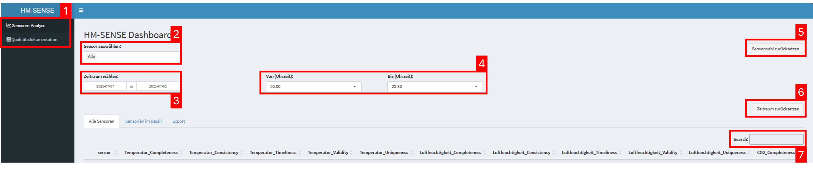
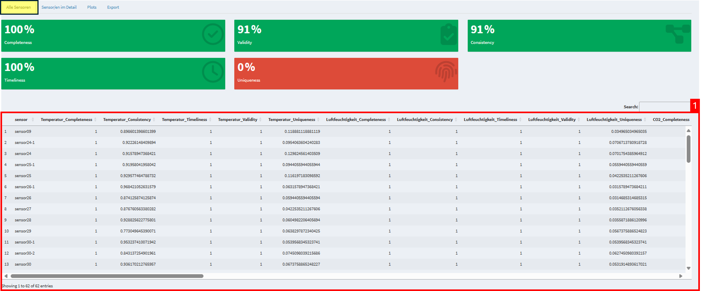
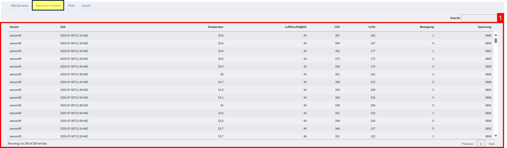
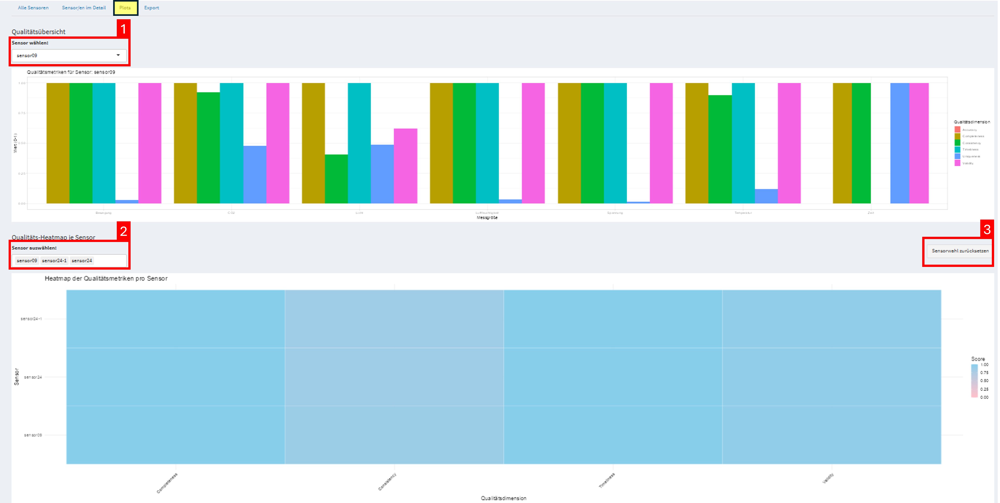
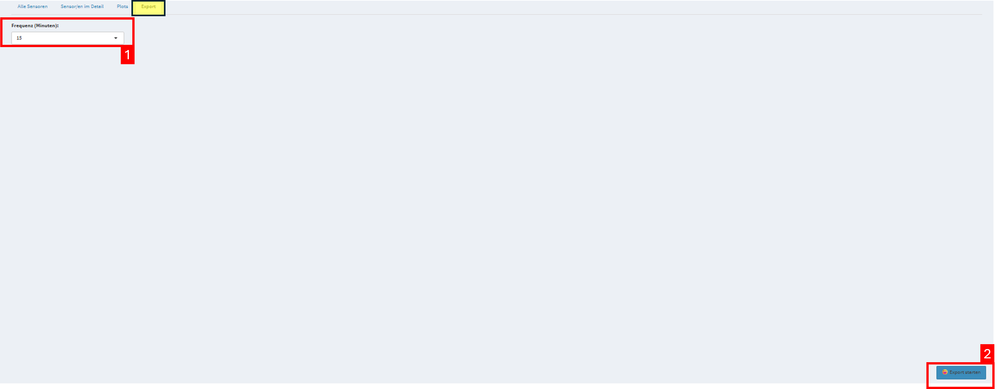

# README - Gruppe 6

# Inhalte der README
- Management Summary
- Verzeichnisstruktur
- Schritt-für-Schritt Anleitung
- Weitere Dokumentationsabschnitte

## Management Summary
- **Ziel:**
    - Entwicklung eines Dashboards zur Übersicht der Datenqualität von Raumklimasensoren aus HMSENSE.
    - Möglichkeit im Dashboard die Daten im CSV-Format zu exportieren.
- **Ansatz:**
    - Umsetzung der Funktionen mit R. und Aufbau des Dashboards mittels Shiny.
    - Einlesen, Aufbereitung und Transformation von Rohdaten aus einer InfluxDB.
    - Bewertung der Daten anhand definierter Qualitätsdimensionen. (Vollständigkeit, Konsistenz, Gültigkeit, Aktualität und Eindeutigkeit)
- **Funktionalitäten des Prototyps:**
    - Interaktive Shiny-App
    - Übersichtstabelle der Qualitätsmetriken je Sensor
    - Filter nach Zeitraum, Uhrzeit und Sensor
    - Detailansicht einzelner Sensoren mit Rohdaten
    - Visualisierung der Qualitätsmetriken einzelner Sensoren
    - Erklärung zu den Qualitätsdimensionen der Daten
    - Export der Daten


## Verzeichnisstruktur

```text
📁 README_Screenhots/               # Ordner für verwendete Screenshots im README
|--- dashboard_alle.png             # Screenshot für Reiter Alle Sensoren - Daten
|--- dashboard_detail.png           # Screenshot für Reiter Sensor/en im Detail
|--- dashboard_export.png           # Screenshot für Reiter Export
|--- dashboard_plot.png             # Screenshot für Reiter Plot
|--- dashboard_uebersicht.png       # Screenshot für Reiter Alle Sensoren - Übersicht
📁 data/                            # Ordner für genutzte und erstellte .csv Dateien
|---📁 testdaten_hmsense/           # Ordner für gegebene Beispieldaten
    |--- r1.csv                     # Beispieldaten 1
    |--- r2.csv                     # Beispieldaten 2
|--- data_quality_report.csv        # Bewertete Datenqualität pro Sensor
|--- influx_block_1.csv             # Rohdatenblock mit allgemeinen Systeminformationen
|--- influx_block_2.csv             # Rohdatenblock mit Eingangsparametern
|--- influx_block_3.csv             # Messblock
|--- influx_block_4.csv             # Rohdatenblock mit Sensortyp-Informationen
|--- influx_block_5.csv             # Rohdatenblock mit Prozessor-Informationen
|--- influx_block_6.csv             # Rohdatenblock mit Ausgangsparametern
|--- influx_block_7.csv             # Relevante Sensordaten (z. B. Temperatur, CO₂)
|--- sensor_daten_buendelt.csv      # Aufbereitete Zeitreihendaten aller Sensoren
📁 shiny/                           # R-Skripte für die Datenaufbereitung und Shiny-App
|--- 01_load_data.R                 # Lädt und speichert Daten aus der InfluxDB als CSV
|--- 02_prepare_sensor_data.R       # Umwandlung in Tabellen und Bewertung der Datenqualität
|--- app.R                          # Shiny-App
.DS_Store                           # macOS-Systemdatei (wird ignoriert)
.gitignore                          # Definiert, welche Datein Git ignorieren soll
Dashboard_Brainstorm_wireframe.pdf  # Sammlung von Ideen zum Dashboard
Entwicklungstagebuch.md             # Entwicklungstagebuch
README.md                           # Diese Datei
Stake_protokoll.md                  # Protokoll des Stakeholder:innen Gespräch
dashboard.Rproj                     # RStudio-Projektdatei zum Projektstart
de_ModA_SoSe25_Teil2_Angabe.pdf     # Aufgabenstellung Modularbeit
setup_install.R                     # Installationsbefehle
```

## Schritt-für-Schritt-Anleitung

Um die Funktionalität des Datenqualitäts-Dashboards zu zeigen, wurden beispiel .csv Dateien im */data* Ordner gespeichert. Diese Daten enthalten die Sensormesswerte für den Zeitraum von 13.06.2025 - 14.06.2025. Eine Unterscheidung nach Raum ist mit den vorhandenen Daten nicht möglich, da man nur die Sensoren eindeutig unterscheiden kann aber die Räume nicht. Falls mit diesen Daten gearbeitet wird, können die Schritte **3. Daten aus der InfluxDB laden und speichern** und **4. Daten aufbereiten und Datenqualität bewerten** übersprungen werden. 

Um die Daten der letzten 24 Stunden zu bekommen muss man die Schritte **3. Daten aus der InfluxDB laden und speichern** und **4. Daten aufbereiten und Datenqualität bewerten** ausführen. **Wichtig** hierbei ist, dass man die config.yml Datei dafür in das Verzeichnis */de_ma_group6* speichern muss, da man diese benötigt um sich mit der InfluxDB zu verbinden. Mit der Ausführung der Schritte 3. und 4. werden die existierenden .csv Dateien in */data* überschrieben.

### **1. Richtiges Arbeitsverzeichnis öffnen**
Um sicherzustellen, dass alle .R-Dateien richtig ausgeführt werden, muss das Projekt mit der *dashboard.Rproj* Datei geöffnet werden. Dies liegt an den relativen Pfaden in den .R-Dateien.

### **2. Benötigte Pakete installieren**
**Benötigte Datei:** `setup_install.R`

**Aktivität:** Führe Sie dieses Skript aus,  um die benötigten Pakete für die Datenvorbereitung und App zu installieren.

**Befehle:** 
| **RStudio Console**      | **Terminal**            |
|--------------------------|--------------------------|
| `source("setup_install.R")` | `Rscript setup_install.R` |

**Was passiert:**
- Prüfung, ob alle benötigten Pakete installiert sind.
- Automatische Installation fehlender Pakete.

### **3. Daten aus der InfluxDB laden und speichern**
**Benötigte Datei:** `01_load_data.R`

**Aktivität:** Führen Sie dieses Skript aus, um die Sensordaten der letzen 24 Stunden aus der InfluxDB zu laden und im Ordner */data* abzuspeichern.

**Befehle:**
| **RStudio Console**      | **Terminal**            |
|--------------------------|--------------------------|
| `source("shiny/01_load_data.R")` | `Rscript shiny/01_load_data.R` |

**Was passiert:**
- Die in der config.yml Datei hinterlegt Datenbankverbindung wird genutzt um die Daten der letzten 24 Stunden zu laden.

- Die gelesenen Daten werden in sieben Blöcke aufgeteilt ("influx_block_x.csv"), wobei nur der Block sieben relevante Daten enthält und im Ordner */de_ma_group6/data* abgepeichert.

### **4. Daten aufbereiten und Datenqualität bewerten**
**Benötigte Datei:** `02_prepare_sensor_data.R`

**Aktivität:** Führen Sie dieses Skript aus, um die relevanten Sensordaten aufzubereiten und zu bewerten.

**Befehle:**
| **RStudio Console**      | **Terminal**            |
|--------------------------|--------------------------|
| `source("shiny/02_prepare_sensor_data.R")` | `Rscript shiny/02_prepare_sensor_data.R` |

**Was passiert:**
- Umwandlung der Messdaten aus "influx_block_7.csv" in das Wide-Format.
- Zusammenführung zu einem einheitlichen Zeitraster.
- Bewertung der Datenqualität anhand definierter Datenqualiätsdimensionen (Accuracy, Completeness, Consistency, Timeliness, Validity und Uniqueness).
- Speicherung der bewerteten Datenqualitätsdimensionen in */de_ma_group6/data/data_quality_report.csv*.
- Speicherung der gebündelten Sensordaten in */de_ma_group6/data/sensor_daten_buendelt.csv*.

### **5. Shiny-App starten**
**Benötigte Datei:** `app.R`

**Aktivität:** Starten Sie die Shiny-App um auf das Dashboard zuzugreifen.

**Befehle:**
| **RStudio Console**      | **Terminal**            |
|--------------------------|--------------------------|
| `shiny::runApp("shiny/03_app.R")` | `Rscript -e "shiny::runApp('shiny/03_app.R')"` |

**Was passiert:**
- Öffnung der Shiny-App in einem RStudio Fenster oder Browserfenster.

### **6. Aufbau des Dashboards**
In diesem Teil der Schritt-für-Schritt Anleitung finden Sie einen Überblick über den Aufbau des Dashboards. Unter den Screenshots finden Sie jeweils eine Erklärung zu den wichtigen Punkten aus dem Screenshot.

**Allgemeines zum Dashboard:**


1. Auswahl der Dashboard Seite in der Navigationsleiste. Unter "Sensoren-Analyse" finden Sie die Analyse der Datenqualitätsdimensionen und unter "Qualitätsdimensionen" finden Sie die Logik zur Bestimmung der verschiedenen Datenqualitätsdimensionen.
2. In diesem Drop-down Menü können Sie auswählen, ob Sie alle Sensoren angezeigt bekommen wollen, oder nur bestimmte Sensoren.
3. In diesem Feld können Sie den Zeitraum für die Sensorwerte auswählen. *Achtung:* In diesem Prototypen sind entweder die vorgegebenen Daten hinterlegt oder die Daten der letzen 24 Stunden, wenn alle R-Skripte ausgeführt worden sind.
4. In diesem Feld können Sie die Uhrzeit festlegen, anhand welcher die Daten bewertet werden sollen.
5. Mit diesem Button können Sie die Sensorwahl zurücksetzen.
6. Mit diesem Button können Sie den Zeitraum zurücksetzen.
7. In diesem Abschnitt sehen Sie eine kompakte Zusammenfassung der Qualitätsdimensionen Bewertung.
8. In diesem Suchfeld können Sie nach bestimmten Sensoren oder Werten suchen.

**Alle Sensoren:**

1. In dem Reiter "Alle Sensoren" sehen Sie alle Sensoren und die Bewertung ihrer Datenqualitätsdimensionen in einer Tabelle.

**Detailansicht:**

1. In dem Reiter "Sensor/en im Detail" sehen Sie die Sensoren, welche Sie im Drop-down Menü im Dashboard ausgewählt haben. In dieser Tabelle sehen Sie die aufbereiteten Messwerte der Sensoren.

**Plotansicht**

1. In diesem Drop-down Menü können Sie einen Sensor auswählen, für welchen die Visualisierung darunter angezeigt werden soll. Die Visualisierung zeigt für jede Messgröße des Sensors die jeweiligen Werte in einem Balkendiagramm.
2. In diesem Drop-down Menü können Sie mehrere Sensoren auswählen, für welche die Visualisierung darunter angezeigt werden soll. Die Visualisierung zeigt dabei die Heatmap der Qualitätsmetriken pro Sensor.

**Export:**

1. In dem Reiter "Export" sehen Sie ein Drop-down Menü, in dem Sie die Frequenz (in Minuten) für den Export festlegen können.
2. Mit diesem Button starten Sie den Export und die Datei wird im Ordner  */de_ma_group6/data* gespeichert.

## Weitere Dokumentationsabschnitte

### *Lösung für Aufgabe 1*

#### Aufgabe 1 – Überblick Datenformat & Transformation

##### 1. Datenabfrage

Die Daten werden über folgende Flux-Abfrage aus der InfluxDB geladen:

```flux
from(bucket: "raumklimasensoren") |> range(start: -1d)
```

Dabei werden alle Daten der letzten 24 Stunden aus dem im `config.yaml` angegebenen Bucket geladen.  
Die Daten werden beim Einlesen automatisch in mehrere CSV-Dateien aufgeteilt (`influx_block_1.csv` bis `influx_block_7.csv`).

---

##### 2. Beobachtungen zu den Daten

- **Formatstruktur**: Alle Dateien enthalten Spalten wie `_time`, `_field`, `_value`, `mqtt_topic`, `host` usw.
- **Datenlayout**: Die Struktur ist im Long-Format. Messgrößen stehen untereinander (`_field`) und die zugehörigen Werte daneben (`_value`).
- **Systemdaten**: Die meisten Dateien enthalten keine Sensordaten, sondern interne Monitoring-Daten (z. B. Fehlerzähler, Buffergrößen).
- **Sensordaten**: Nur `influx_block_7.csv` enthält echte Raumklima-Sensordaten (z. B. CO₂) mit `mqtt_topic`.
- **Zeitformat**: Die Zeitstempel liegen im UTC-Format mit Nanosekundenauflösung vor (`X_time`).
- **Sensorbezug**: Der Sensorname kann aus dem `mqtt_topic`-Pfad extrahiert werden (z. B. `"sensor09"`).
- **Raumbezug**: Es existiert kein explizites Feld für Raumangaben. Eine Zuordnung müsste ggf. manuell ergänzt werden.
- **Zeitabstände**: Die Daten kommen nicht gleichmäßig verteilt (asynchron) und erfordern eine Transformation auf ein gleichmäßiges Zeitraster.

---

##### 3. Probleme und pragmatische Lösungen

| Problem                                 | Lösungsvorschlag                                                              |
|----------------------------------------|-------------------------------------------------------------------------------|
| Systemdaten im Datensatz enthalten     | Nur Daten mit `mqtt_topic` und `uplink_message_*` berücksichtigen            |
| Daten im Long-Format                   | Umwandlung in Wide-Format mit `pivot_wider()`                                |
| Sensorname nicht direkt als Spalte     | Extraktion aus `mqtt_topic` mit regulärem Ausdruck (`sensor[0-9]+`)          |
| Kein Raum-Feld vorhanden               | Manuelle Zuordnung von Sensoren zu Räumen (z. B. über Mapping-Tabelle)       |
| Zeitstempel mit Nanosekunden, unregelmäßig | Konvertierung zu `POSIXct`, anschließend auf z. B. 15-Minuten-Raster runden |

---

##### 4. Weiteres Vorgehen

Für das Dashboard zur Übersicht der Datenqualität ist nur die Datei `influx_block_7.csv` relevant.  
Alle anderen Dateien enthalten ausschließlich technische Monitoring-Daten ohne Sensorbezug und werden daher ausgeschlossen.

Für die Weiterverarbeitung sind folgende Transformationen erforderlich:

- Filtern der relevanten Sensor-Messwerte
- Umwandlung ins Wide-Format für nutzerfreundliche Analyse
- Normierung der Zeitabstände auf gleichmäßige Intervalle
- *(Optional)*: Ergänzung einer Sensornamen-Raum-Zuordnung
